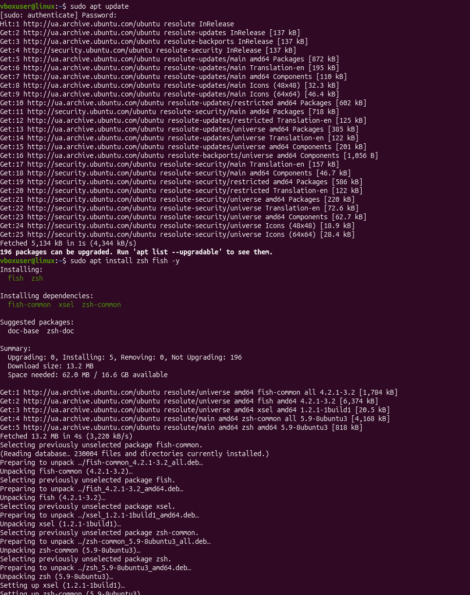
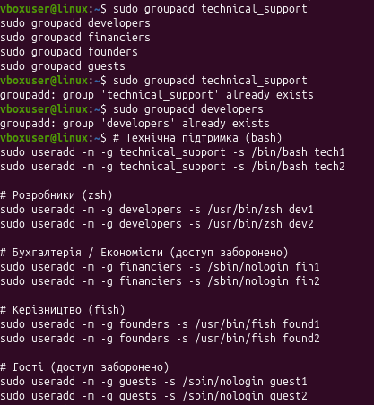
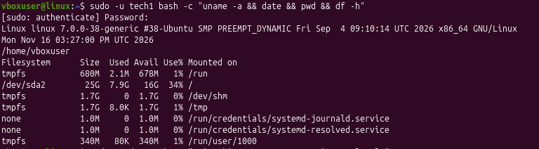
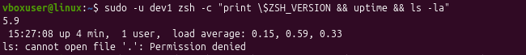
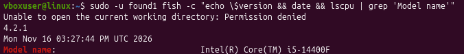
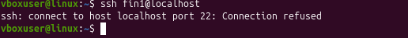

Звіт з виконання Ворк-кейсу №6
1. Встановлення та характеристика додаткових командних інтерпретаторів
Окрім стандартного bash, для виконання завдання було обрано два популярні альтернативні інтерпретатори: Zsh (Z Shell) та Fish (Friendly Interactive Shell).

Короткі характеристики інтерпретаторів:
Zsh (Z Shell):
Можливості: Потужний розширений інтерпретатор, сумісний із Bourne Shell (sh) та bash. Має надзвичайно гнучку систему автодоповнення, виправлення помилок у введених командах, розширене групування файлів (globbing) та потужну екосистему фреймворків (наприклад, Oh My Zsh). Популярний серед розробників завдяки високій кастомізації.
Fish (Friendly Interactive Shell):
Можливості: Створений з акцентом на зручність для користувача "з коробки". Має кольорове підсвічування синтаксису в реальному часі, автодоповнення на основі історії попередніх команд та веб-інтерфейс для налаштування (fish_config). Не вимагає складних конфігураційних файлів для базового комфорту.
2. Створення груп та користувачів
Для розподілу ролей у системі створено 5 груп відповідно до вимог та 10 облікових записів користувачів (по 2 користувачі на кожну групу):

3. Налаштування інтерпретаторів за замовчуванням
Відповідно до умов завдання, налаштовано такі командні оболонки для груп:

Technical support: /bin/bash

Developers: /usr/bin/zsh

Financiers: /sbin/nologin (обмеження доступу до інтерактивного шелу)

Founders: /usr/bin/fish

Guests: /sbin/nologin (обмеження доступу до інтерактивного шелу)

(Примітка: під час створення користувачів за допомогою параметра -s шлях до оболонки або засіб блокування доступу /sbin/nologin було призначено автоматично).
4. Демонстрація роботи користувачів у відповідних інтерпретаторах
1. Група Technical support (tech1, оболонка /bin/bash):
Перевірка конфігурації системи, поточної дати та версії ОС:

2. Група Developers (dev1, оболонка /usr/bin/zsh):
Збір відомостей про середовище розробника та робочі каталоги:

3. Група Founders (found1, оболонка /usr/bin/fish):
Перевірка конфігурації за допомогою Fish-синтаксису:

4. Групи Financiers та Guests (fin1, guest1, оболонка /sbin/nologin):
При спробі інтерактивного входу в систему через SSH або термінал користувачі отримують сповіщення про заборону доступу:

Glossary & Conclusions (English)
5. Glossary of Terms
Shell Interpreter — A command processor that operates as the outermost layer of the operating system, translating user commands into system calls.

User Group — A collection of system users sharing common security and permission privileges.

Default Shell — The standard command interpreter assigned to a user account, launched automatically upon login.

Nologin — A pseudo-shell used to disable interactive shell access for system or service accounts.

System Configuration — The process of setting up parameters, hardware details, environment variables, and user access levels.

6. Conclusion
During the completion of Work-case 6, practical skills in user management, group creation, and shell assignment in Linux systems were successfully acquired. 
Alternative command-line interpreters (zsh and fish) were installed and compared, demonstrating enhanced user experience features like autosuggestions and rich styling. 
Furthermore, security policies were applied by restricting shell access for specific departments (Financiers and Guests) using /sbin/nologin.
