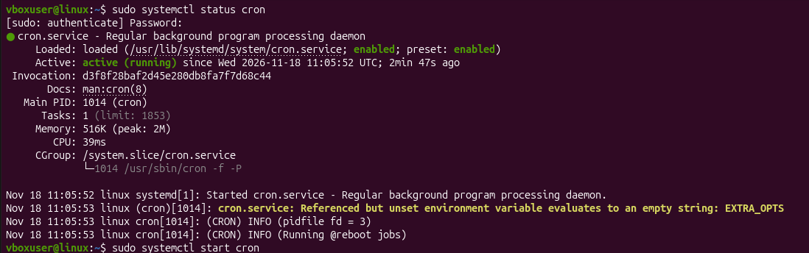
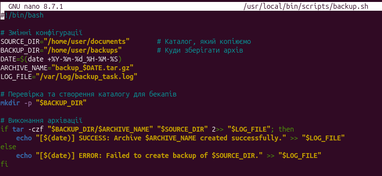

Звіт до Work-case 7: Планування завдань в операційних системах (Task Scheduling in Operating Systems)
1. Планування завдань в ОС: теоретичні засади та порівняння
Охарактеризуйте основні функції планувальника завдань в будь-якій ОС
Планувальник завдань (Task Scheduler / Job Scheduler) — це підсистема операційної системи, призначена для автоматичного запуск процесів, скриптів або програм у визначений час або за певних умов без безпосередньої участі користувача.

Основні функції:

Автоматизація (Automation): Виконання рутинних операцій за розкладом (бекапи, очищення кешу, оновлення).

Керування часом та подіями (Time & Event Triggering): Запуск за календарним графіком (хвилина, година, день тижня) або за системними подіями (завантаження системи, входження в систему, бездіяльність).

Облік прав доступу та безпеки (Security & Context): Виконання завдань від імені певного користувача (з відповідними правами доступу).

Обробка винятків та логування (Logging & Error Handling): Запис результатів виконання (stdout/stderr) у лог-файли для моніторингу помилок.

Керування ресурсами (Resource Management): Балансування навантаження на систему шляхом відкладання ресурсоємних завдань на години мінімального навантаження (night maintenance).

Порівняння планувальників Windows та Linux
| Критерій порівняння | Windows Task Scheduler |Linux Cron / Systemd Timers|
| :--- | :--- | :--- |
| Інтерфейс | Графічний (GUI - Task Scheduler MMC) та CLI (schtasks). | Переважно командний рядок (CLI), текстові файли конфігурації.  |   
| Тригери (Умови запуску) | Широкий набір: час, лог подій (Event Logs), старт системи, просте підключення до мережі, бездіяльність. | Часові інтервали (cron) або системні події/залежності (systemd timers).  |   
| Контекст виконання | Може виконувати завдання як від імені активного користувача, так і SYSTEM / LocalService. | Запускається від імені конкретного користувача (у разі crontab) або systemd-служби.  |   
| Надійність / Навантаження | Інтегрований у графічну оболонку, важчий для серверних headless-конфігурацій. | Легковагові фонові демони (cron, systemd), ідеально підходять для серверів.  | 

Планувальник Cron в ОС Linux:принципи роботи та налаштування
Cron — це стандартний фоновий демон у Unix-подібних ОС для виконання завдань за розкладом. Основні компоненти:

crond: демон, що працює у фоновому режимі та щохвилини перевіряє таблиці розкладу (crontab).

crontab: файл конфігурації для кожного користувача, що містить розклад завдань.

Кожне завдання задається рядком із 5 полів часу та дати, за якими слідує команда
* * * * * /path/to/command
перша * ще хвилини
друга * це години
третя * це дні 
четверта * місяць
п'ята * день тижня
Спеціальні символи: * (будь-яке значення), , (список значень, наприклад 1,15,30), - (діапазон, наприклад 1-5), / (крок, наприклад */15 — кожні 15 хвилин).

Керування та налаштування:
Редагування розкладу поточного користувача: crontab -e

Перегляд списку завдань: crontab -l

Видалення всіх завдань: crontab -r

Системні завдання зберігаються у каталозі /etc/crontab або в каталогах /etc/cron.d/, /etc/cron.daily/, тощо.

Альтернативи Cron:
Anacron: Розроблений для систем, які не працюють цілодобово (наприклад, ноутбуки). Якщо комп'ютер був вимкнений у момент запланованого часу, Anacron виконає завдання одразу після увімкнення.

Systemd Timers: Сучасна заміна cron у дистрибутивах із системою ініціалізації systemd. Використовує два файли: службовий (.service) та таймерний (.timer). Дозволяє прив'язувати завдання до завантаження системи, переходу в сплячий режим та вести гнучке логування через journald.

at / batch: Інструменти для одноразового виконання завдань у визначений момент у майбутньому.

2 Планування завдань через Cron (Практична реалізація)
2.1спочатку я запустив саму крон бо вона була вилючена

2.2тепер ми прописуємо перший скрипт (Скрипт резервного копіювання та архівування)
Цей скрипт створює стиснений архів (.tar.gz) вибраної папки з унікальною міткою часу та записує результат у лог-файл.   
![Image alt]https://github.com/MEskiti/-2-/blob/main/%D0%97%D0%BD%D1%96%D0%BC%D0%BE%D0%BA%20%D0%B5%D0%BA%D1%80%D0%B0%D0%BD%D0%B0%202026-11-18%20131422.png

2.3Скрипт очищення каталогів та видалення старих файлів (/usr/local/bin/scripts/cleanup.sh)
Цей скрипт видаляє тимчасові файли або логи, які старші за певний період (наприклад, понад 7 днів).

2.4 Скрипт щоденної чи робочої задачі (/usr/local/bin/scripts/daily_task.sh)
Простий скрипт перевірки стану дискового простору або синхронізації:
[Image alt](https://github.com/MEskiti/-2-/blob/main/%D0%97%D0%BD%D1%96%D0%BC%D0%BE%D0%BA%20%D0%B5%D0%BA%D1%80%D0%B0%D0%BD%D0%B0%202026-11-18%20132527.png)

2.5. Додавання завдань до Cron (Конфігурація розкладу)
[Image alt](https://github.com/MEskiti/-2-/blob/main/%D0%97%D0%BD%D1%96%D0%BC%D0%BE%D0%BA%20%D0%B5%D0%BA%D1%80%D0%B0%D0%BD%D0%B0%202026-11-18%20132820.png)
