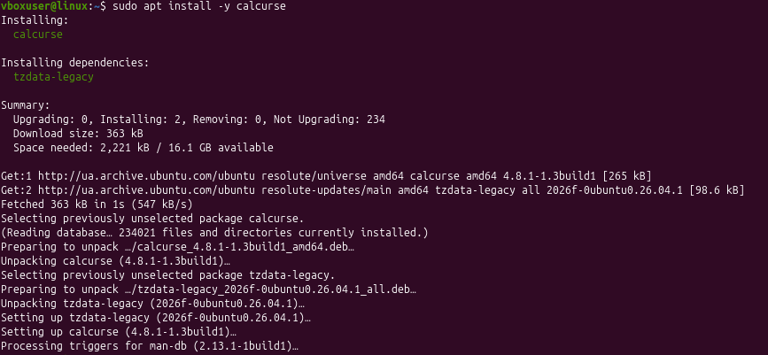
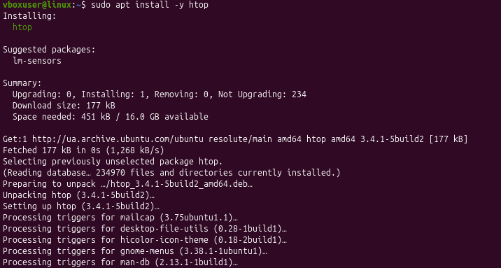
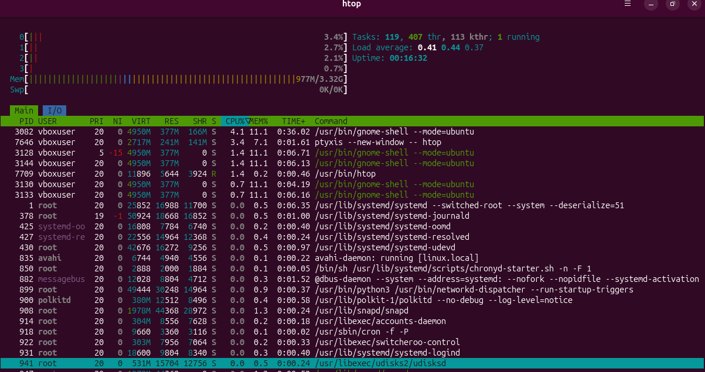
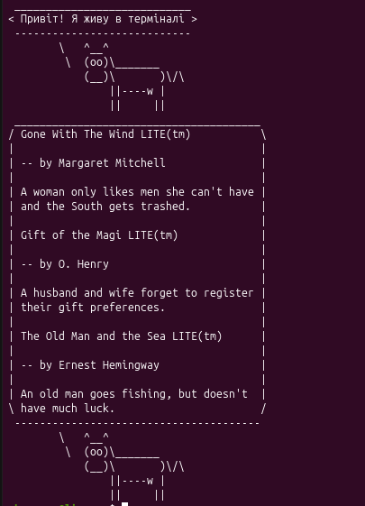
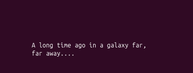
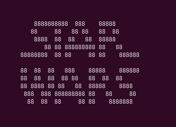
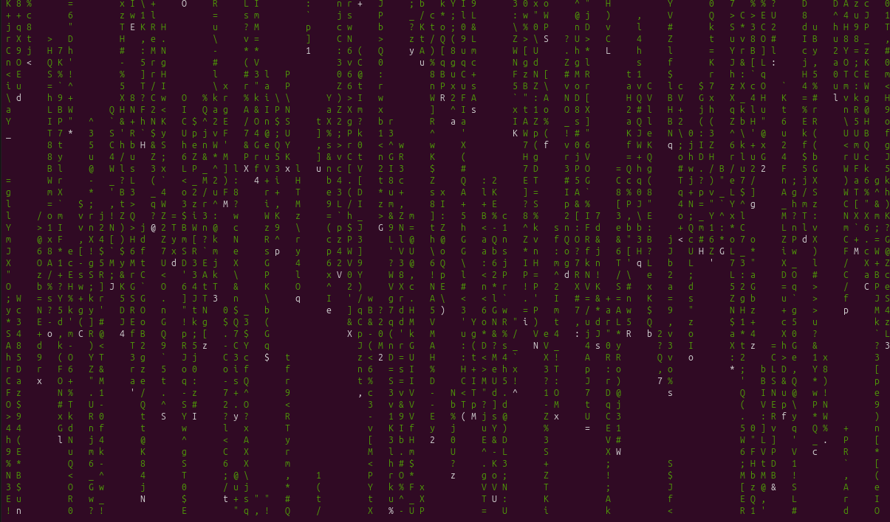
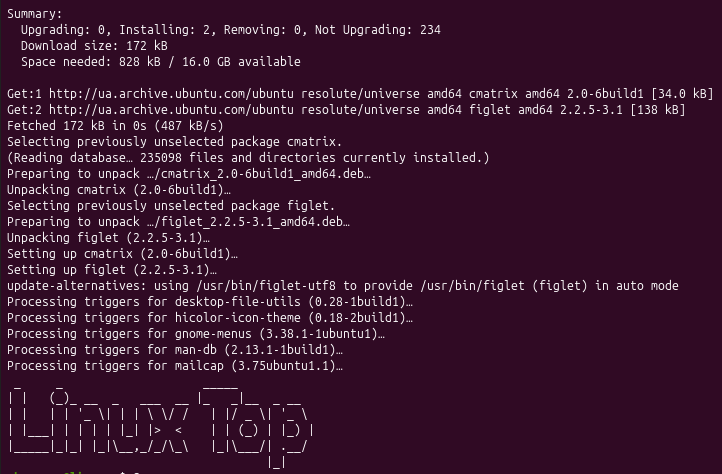

Glossary of Terms (Словник англійських термінів)
CLI (Command-Line Interface) — a text-based interface used to interact with an operating system by typing commands.

TUI (Text-based User Interface) — a pseudo-graphical interface rendered using text characters and blocks inside a terminal window.

GUI (Graphical User Interface) — a visual interface with windows, icons, and buttons controlled via a mouse or touchscreen.

Terminal Emulator — a program that opens a window and lets the user interact with the system shell.

Shell — a command interpreter (such as Bash or Zsh) that processes user commands and executes programs.

Package Manager — a tool (such as apt, dnf, or pacman) used to install, update, and remove software packages automatically.

Repository — a centralized storage location on remote servers from which software packages are retrieved and installed.

Daemon / Background Process — a program that runs continuously in the background without direct user interaction.

Process Monitoring — tracking active tasks, CPU load, and memory consumption in real time.

SSH (Secure Shell) — a cryptographic network protocol used for secure remote command-line access to Linux servers.

ASCII Art — a graphic design technique that creates images and animations using printable text characters.

Easter Egg — a hidden joke, feature, or animation intentionally placed inside software by developers.

1. Робота у терміналі без графічної оболонки
Файловий менеджер у терміналі (mc, ranger, lf, nnn)
Встановлення та запуск: sudo apt update && sudo apt install mc $\rightarrow$ запуск: mc.
Як працює: Midnight Commander (mc) відкриває двопанельний інтерфейс з підтримкою миші (у багатьох терміналах), копіювання, переміщення, роботи з архівами та вбудованого переглядача/редактора. Як легші альтернативи популярні ranger або lf.
Текстовий браузер (w3m)
Як працює: Рендерить HTML-сторінки в текстовому вигляді, підтримує перехід за посиланнями, форми та закладки. Сучасні важкі JS-сайти відображає частково або без скриптів, зате ідеально підходить для документації, локальних панелей і швидкого перегляду тексту.

Поштовий клієнт (neomutt)
Як працює: NeoMutt підключається до поштових скриньок через протоколи IMAP/POP3 і надсилає листи через SMTP (часто у зв'язці з msmtp або isync/mbsync). Дає повний контроль над теками, фільтрами, пошуком і GPG-підписами без зайвої графіки.

Музичний плеєр (cmus)
Як працює: cmus — швидкий консольний аудіоплеєр із бібліотекою треків, плейлистами, чергами та керуванням гарячими клавішами. Для аудіопотоків або локальних файлів також зручний mpv --no-video <файл_або_URL>.

Завантаження торентів (rtorrent)
Як працює: rTorrent запускається в терміналі (його часто тримають у tmux або screen, щоб завантаження не зупинялося після закриття сесії). Підтримує .torrent-файли, magnet-посилання, обмеження швидкості та керування роздачами.

Календар та планувальник (calcurse)
Як працює: calcurse поєднує календар, список задач (TODO) і сповіщення про наближення подій. Для разових командних нагадувань у певний час у системі є утиліта at (наприклад, echo "notify-send 'Перерва'" | at 15:00) або systemd-run.

Перегляд зображень (chafa)
Як працює: Утиліти перетворюють пікселі зображення у символи Unicode (наприклад, блоки) з 24-бітними кольорами ANSI, а в сучасних терміналах (як-от Kitty, WezTerm, iTerm2) можуть виводити графіку ще чіткіше через протоколи терміналу.

2. Класичні інструменти адміністратора
Текстові редактори
Для роботи з конфігураціями та скриптами по SSH класикою є:
Системний монітор (htop)
Для аналізу завантаження CPU, ОЗП, дисків і процесів використовують:

4. «Пасхалки» та розваги
Діалог з коровою (cowsay + fortune)
Корова виводить текст у хмаринці, fortune підбирає випадкову цитату чи жарт, а lolcat розфарбовує вивід градієнтом.

«Зоряні війни» (через telnet)
Багато користувачів пам'ятають класичну текстову анімацію IV епізоду через telnet towel.blinkenlights.nl. Через зміну роботи публічних сервісів цей хост часто недоступний напряму, але в репозиторіях або на GitHub є локальні/альтернативні ASCII-анімації та клієнти, які можна запускати локально без залежності від зовнішнього telnet-сервера.

Додаткові інтерактиви («Матриця» та великий текст)

Conclusion (Висновки)
During this practical work, I explored the capabilities of the Linux command-line interface (CLI) and text-based user interfaces (TUI) for performing everyday and administrative tasks without a graphical desktop environment.

Full Functionality Without a GUI: Even on resource-constrained systems or headless servers, users can manage files (mc), browse the web (w3m), check emails (neomutt), listen to music (cmus), download torrents (rtorrent), plan schedules (calcurse), and preview images (chafa) directly inside the terminal.

Essential Administration Tools: Text editors (nano, vim) and real-time resource monitors (htop, btop) provide fast, lightweight, and reliable control over system configurations and running processes, especially when working remotely over SSH.

Interactive Environment: Built-in utilities and playful "Easter eggs" (sl, cowsay, cmatrix, figlet) demonstrate the flexibility of standard input/output streams and pipes in Linux while making terminal workflows more engaging.

Overall, mastering terminal utilities significantly reduces hardware overhead, speeds up routine operations, and is a fundamental skill for effective Linux system administration.

