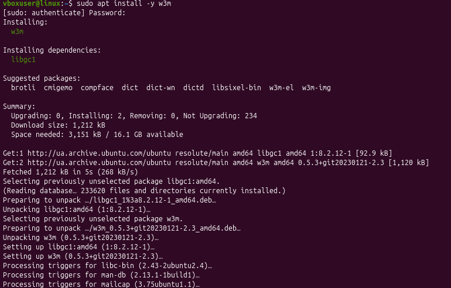
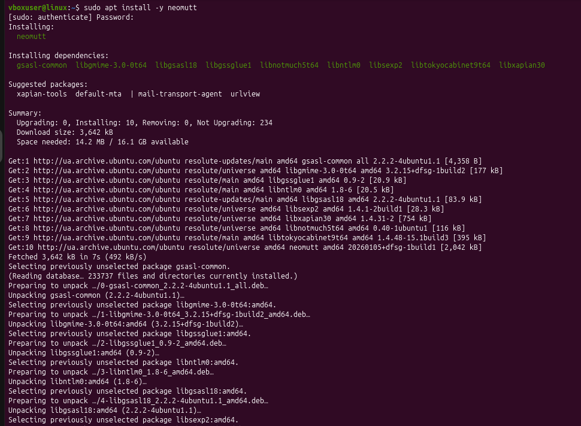
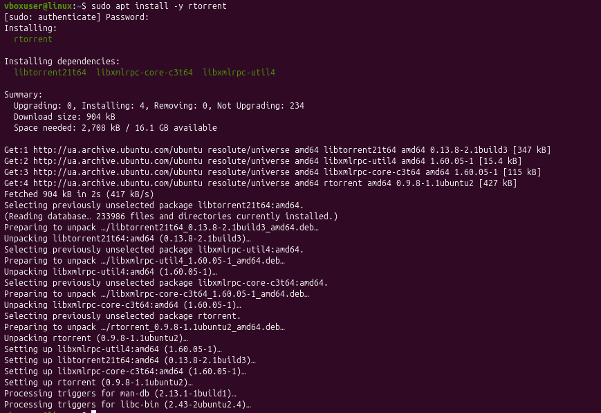
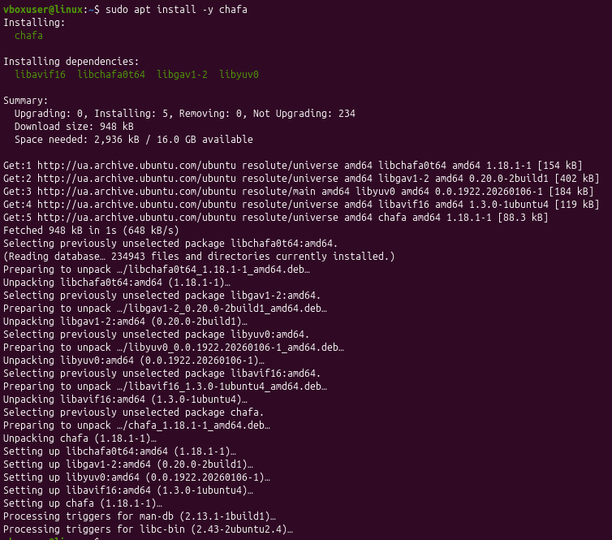

1. Робота у терміналі без графічної оболонки
Файловий менеджер у терміналі (mc, ranger, lf, nnn)
Встановлення та запуск: sudo apt update && sudo apt install mc $\rightarrow$ запуск: mc.
Як працює: Midnight Commander (mc) відкриває двопанельний інтерфейс з підтримкою миші (у багатьох терміналах), копіювання, переміщення, роботи з архівами та вбудованого переглядача/редактора. Як легші альтернативи популярні ranger або lf.
Текстовий браузер (w3m)
Як працює: Рендерить HTML-сторінки в текстовому вигляді, підтримує перехід за посиланнями, форми та закладки. Сучасні важкі JS-сайти відображає частково або без скриптів, зате ідеально підходить для документації, локальних панелей і швидкого перегляду тексту.

Поштовий клієнт (neomutt)
Як працює: NeoMutt підключається до поштових скриньок через протоколи IMAP/POP3 і надсилає листи через SMTP (часто у зв'язці з msmtp або isync/mbsync). Дає повний контроль над теками, фільтрами, пошуком і GPG-підписами без зайвої графіки.

Музичний плеєр (cmus)
Як працює: cmus — швидкий консольний аудіоплеєр із бібліотекою треків, плейлистами, чергами та керуванням гарячими клавішами. Для аудіопотоків або локальних файлів також зручний mpv --no-video <файл_або_URL>.

Завантаження торентів (rtorrent)
Як працює: rTorrent запускається в терміналі (його часто тримають у tmux або screen, щоб завантаження не зупинялося після закриття сесії). Підтримує .torrent-файли, magnet-посилання, обмеження швидкості та керування роздачами.

Календар та планувальник (calcurse)
Як працює: calcurse поєднує календар, список задач (TODO) і сповіщення про наближення подій. Для разових командних нагадувань у певний час у системі є утиліта at (наприклад, echo "notify-send 'Перерва'" | at 15:00) або systemd-run.

Перегляд зображень (chafa)
Як працює: Утиліти перетворюють пікселі зображення у символи Unicode (наприклад, блоки) з 24-бітними кольорами ANSI, а в сучасних терміналах (як-от Kitty, WezTerm, iTerm2) можуть виводити графіку ще чіткіше через протоколи терміналу.

2. Класичні інструменти адміністратора

